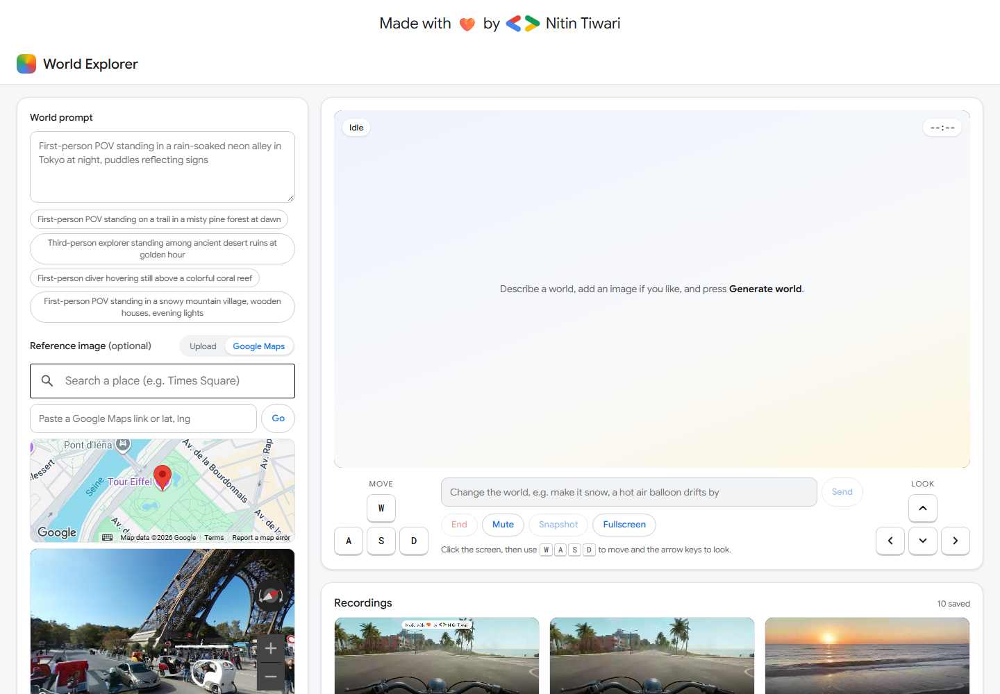
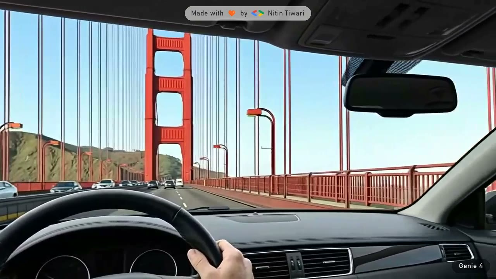

# Genie 4 World Explorer

Play worlds generated live by Google's **Genie 4** world model in your browser.
Describe any world, or pick a real place on Google Maps and walk through it.



## Features

- Text prompt, with an optional reference image
- Google Maps picker: search, click the map, or paste a Maps link, then use the Street View frame as the reference
- Live play with `W` `A` `S` `D` and the arrow keys, plus text events like "make it snow"
- Low-latency WebRTC stream straight from Genie 4
- Every session saved as an MP4, with a credit and a Genie 4 badge

## Results

### Imagination: Vice City

Prompt: `GTA VI bike riding in Vice City.`


### Real world: Golden Gate Bridge

A drive across the Golden Gate Bridge, started from a real photo of the bridge road.

Prompt: `Immersive first-person cockpit POV gripping the black leather steering wheel of a car stationary in the right lane of the main road on the Golden Gate Bridge, exactly as in the reference image.`



Reference photo: [Driving North on the Golden Gate Bridge](https://commons.wikimedia.org/wiki/File:Driving_North_on_the_Golden_Gate_Bridge.jpg) by Hnapel, CC BY-SA 4.0.

## Setup

Needs Python 3.10+, a paid-tier Gemini API key and a Google Maps API key.

```powershell
python -m venv .venv
.venv\Scripts\pip install -r requirements.txt
copy .env.example .env
.venv\Scripts\python app.py
```

Fill in `.env`, then open http://localhost:5000 in Chrome or Edge.

Enable these on the Maps key: Maps JavaScript API, Places API (New), Street View Static API.

## How it works

1. Flask creates a Genie 4 interaction and a short-lived token for it.
2. The browser connects to Genie over WebRTC with that token. Your API key stays on the server.
3. Video and audio arrive as media tracks. Keys and text go over a data channel.
4. The browser records the session and Flask saves it as MP4.

## Notes

- Output is 1280x720. Sessions last up to 120 seconds.
- Genie 4 is served from the US, Western Europe and Japan. Farther away, controls lag more.
- Prompts that put you somewhere still work best, like "First-person POV standing on...".
- About $0.10 per second of world.

## License

Apache 2.0. See [LICENSE](LICENSE).

## Credits

Made with 🧡 by Nitin Tiwari.
